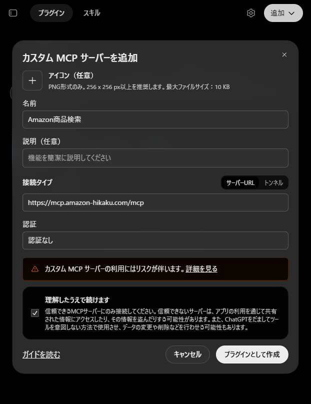

# amazon-hikaku MCP サーバー

[ポちのAmazon商品徹底比較.com](https://www.amazon-hikaku.com/)（amazon-hikaku.com）の調査データを、ChatGPT や Claude などの AI アシスタントから直接検索・参照できるようにする MCP サーバーです。

サイトが調査した約7,400商品について、独自スコア（0〜100点）、価格、スペック、長所・短所、スコアの採点根拠などを、AI がそのまま使える形で返します。買い物の相談をするときにこのサーバーを接続しておくと、AI が実際の調査データに基づいて候補を挙げ、比較し、出典として商品詳細ページへのリンクを添えて回答できます。

- **エンドポイント**: `https://mcp.amazon-hikaku.com/mcp`
- **認証**: 不要（公開・読み取り専用）
- **方式**: MCP / Streamable HTTP

## 接続方法

### ChatGPT（Web版）

1. 左メニューの「プラグイン」を開く
2. 「追加」（＋ボタン）→「カスタム MCP サーバーを追加」
3. 名前（例: `Amazon商品検索`）を入力し、「接続」のサーバー URL に `https://mcp.amazon-hikaku.com/mcp` を入力。認証は「認証なし」を選ぶ
4. リスクに関する警告を確認し、「内容を理解したうえで続行」を選択
5. 「プラグインとして作成」→ 検出されたツールを確認してインストール
6. チャットで入力欄に `@` と入力し、このプラグインを選んで質問する

入力画面の例（名前は任意です）:



### Claude

1. 左メニューの「プラグイン」を開く
2. 「追加」→「カスタムコネクタを追加」
3. 名前（例: `Amazon商品検索`）と MCP サーバー URL `https://mcp.amazon-hikaku.com/mcp` を入力
4. 認証は「サインインなし」を選んで追加
5. チャットで「+」→「コネクタ」から有効にして質問する

入力画面の例（名前は任意です）:


### Grok

1. 設定 →「Connect Apps」を開き、下の方にある「Add a custom connector」を選ぶ
2. 名前（例: `Amazon商品検索`）とサーバー URL `https://mcp.amazon-hikaku.com/mcp` を入力（ヘッダーは空で構いません）
3. 「MCPを追加」

入力画面の例（名前は任意です）:


### MCP 対応クライアント全般（Claude Code / Cursor など）

MCP サーバーの設定に以下を追加してください。

```json
{
  "mcpServers": {
    "amazon-hikaku": {
      "url": "https://mcp.amazon-hikaku.com/mcp"
    }
  }
}
```

## 使い方の例

接続した AI に、たとえばこう聞けます。

- 「3万円以下で評価の高いワイヤレスイヤホンを探して」
- 「Anker のモバイルバッテリーで一番おすすめはどれ？」
- 「この2つの商品（ASIN: B0… と B0…）を比較して」
- 「今セールで30%以上安くなっている商品を教えて」
- 「ブラックフライデーのセールでおすすめはある？」（セールの種類は商品ごとのバッジで区別されます。開催前など該当がない時期は、その旨と現在開催中のセールが返ります）
- 「送料無料まであと少し。2,000円以下で良いものある？」
- 「スコア90点以上の商品だけ見せて」

AI は出典として amazon-hikaku.com の商品詳細ページへのリンクを添えて回答します。詳しいスペック表や価格推移（Keepa）はそちらで確認できます。

条件が曖昧な相談では、AI が予算・用途などの絞り込みを聞き返すことがあります。そのまま答えると、条件に合わせて候補を調べ直してくれます。

## 使えるツール

| ツール | 内容 |
|---|---|
| `search_products` | キーワード／カテゴリ／ブランド／価格／スコアで商品を検索 |
| `get_product` | 1商品の詳細（スペック、在庫、調査日、スコアの採点根拠） |
| `compare_products` | 2〜5商品の横並び比較 |
| `list_categories` | カテゴリ一覧（親→子の階層と件数） |
| `list_brands` | ブランド検索（表記揺れにも対応） |
| `get_deals` | セール中の商品（割引率順。低スコア品を避けるため既定でスコア70点以上。セール種別での絞り込みも可） |
| `get_bargain` | 目標金額以下の「あともう一品」候補 |
| `get_recommendations` | スコア90点以上の高評価商品 |

## 相談プロンプト（MCP Prompts）

ツールのほかに、相談の進め方を AI に渡すテンプレート（プロンプト）を2件用意しています。MCP Prompts に対応したクライアントでは、コマンドやテンプレートとして選べます（対応状況はクライアントによります）。

| プロンプト | 内容 |
|---|---|
| `shopping_consultation` | 買い物相談用。まず候補を調べ、予算・用途などが曖昧なら実際の選択肢で最大3点まで聞き返し、回答に合わせて再検索して比較と推奨まで進める。引数 `topic` にテーマ（例: ワイヤレスイヤホン）を渡せる |
| `bargain_hunting` | セール・買い合わせ相談用。セール商品と「あと一品」候補を、割引率だけでなくスコアも見て絞り込む。引数 `occasion` に用途を渡せる |

## データについて

- データは amazon-hikaku.com の調査結果そのもので、サーバー側で1時間ごとに最新の公開データへ更新されます
- 価格は各商品の「調査時点」の価格です。最新の価格はリンク先の詳細ページでご確認ください
- スコアはサイト独自の採点（基本点＋加点・減点）で、各商品の `score_rationale` に根拠が入っています
- 書き込み機能はありません。検索と参照だけの読み取り専用です

## 関連リンク

- [amazon-hikaku.com](https://www.amazon-hikaku.com/) — 本体サイト
- [AI・LLM向け案内（llms.txt）](https://www.amazon-hikaku.com/llms.txt) — データ取得方法のまとめ

---

開発者向けの情報（構成、デプロイ方法、設計上の注意）は [AGENTS.md](AGENTS.md) を参照してください。
