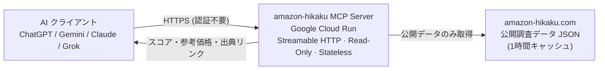
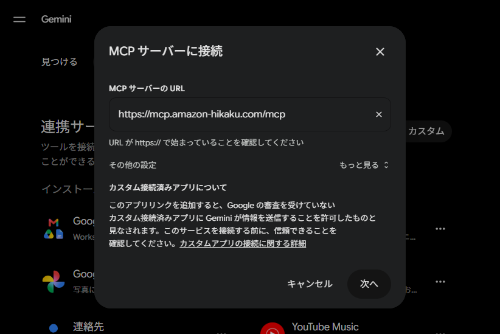
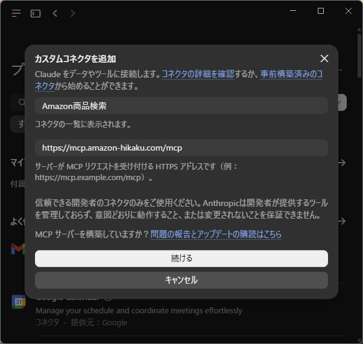
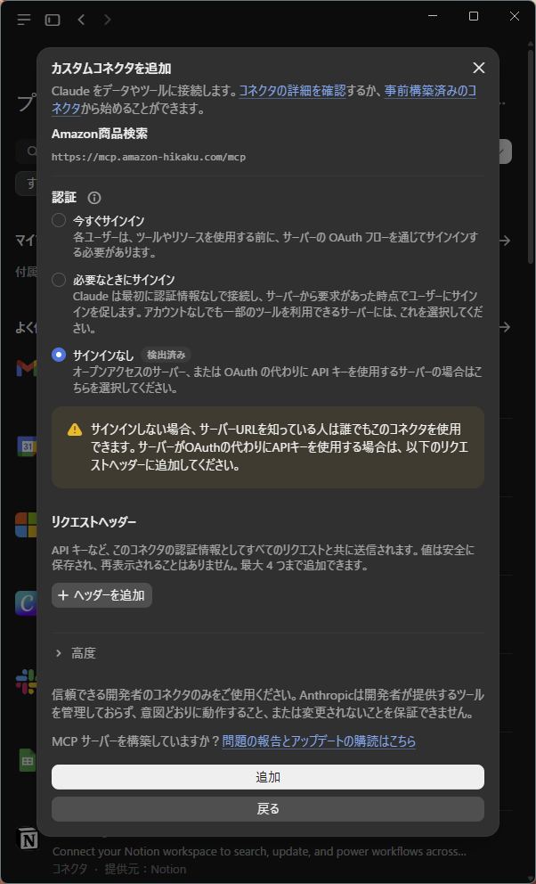
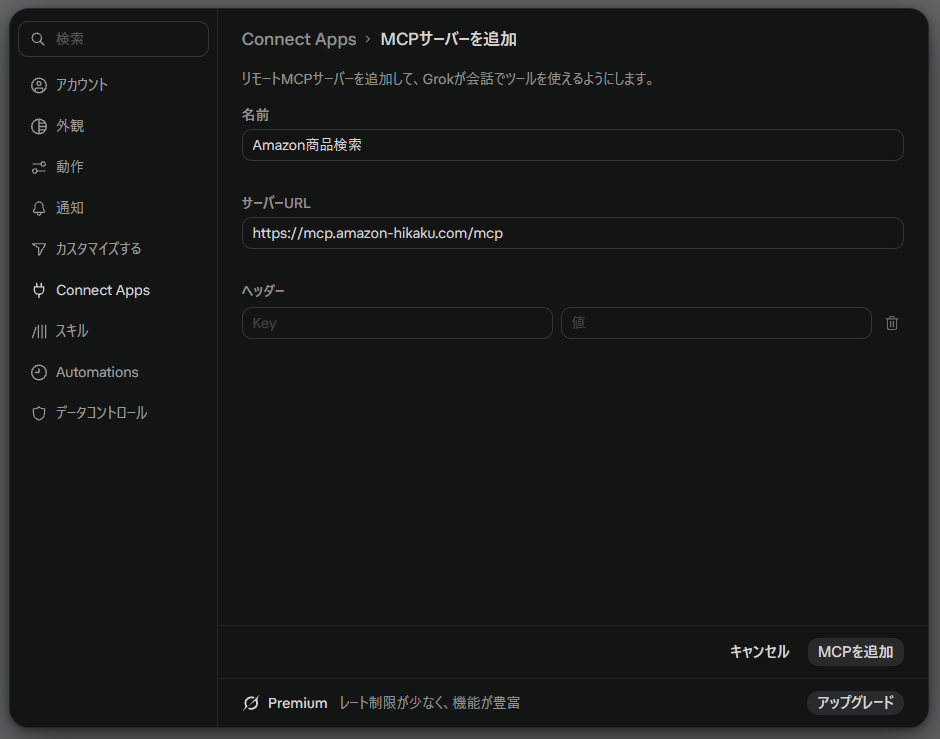

<div align="center">

# amazon-hikaku MCP Server

**Amazon商品調査データベース（7,000点以上）を、ChatGPT・Gemini・Claude・Grok から直接検索・比較できる読み取り専用 MCP サーバー**

[-1D4ED8?style=flat-square)](https://modelcontextprotocol.io/)
[-059669?style=flat-square)](#クイックスタート)
[](#セキュリティと信頼性設計)
[](#アーキテクチャ)
[](LICENSE)

[クイックスタート](#クイックスタート) · [利用例](#利用例) · [提供ツール](#提供ツール) · [相談プロンプト](#相談プロンプトmcp-prompts) · [セキュリティ](#セキュリティと信頼性設計) · [本体サイト](https://www.amazon-hikaku.com/)

</div>

---

[ポちのAmazon商品徹底比較.com](https://www.amazon-hikaku.com/) が独自に調査・採点した Amazon.co.jp の商品データ（独自スコア 0〜100点、参考価格、スペック、長所・短所、採点根拠）を、MCP 対応 AI アシスタントから直接検索・比較できるリモート MCP サーバーです。

> [!TIP]
> **認証・APIキー・アプリインストールは不要です。** 以下のエンドポイント URL を AI クライアントに登録するだけで利用できます。
>
> ```text
> https://mcp.amazon-hikaku.com/mcp
> ```

---

## 主な特徴

- **根拠と出典つきの推薦**: AI の記憶ではなく実測調査データに基づいて候補を抽出し、独自スコア・参考価格・詳細レポート URL を必ず併記します。
- **日本語の自然な相談に対応**: ブランドの日英表記ゆれ（`ソニー` ↔ `Sony` 等）や略語・規格表記（`ノイキャン`、`USB-C` / `Type-C`、`モババ` 等）を自動で吸収します。
- **比較・代替品・セール特化ツール**: 2〜5商品の構造化比較、在庫切れ・予算超過時の近接価格帯代替提案、セール種別（タイムセール／プライム会員限定等）での絞り込みに対応しています。
- **読み取り専用・ステートレス**: 書き込み・購入操作は一切なく、会話履歴や個人情報をサーバー側に保存しません。

---

## アーキテクチャ



---

## クイックスタート

どのクライアントでも、設定する項目は **名前（任意・例：`Amazon商品検索`）** と **サーバー URL（`https://mcp.amazon-hikaku.com/mcp`）** の 2 点のみです。認証は「なし／サインインなし」を選択してください。

<details open>
<summary><strong>ChatGPT（Web版）</strong></summary>

1. 左メニューの **「プラグイン」** を開く
2. **「追加」（＋ボタン）** → **「カスタム MCP サーバーを追加」** を選択
3. 名前（例: `Amazon商品検索`）、サーバー URL に `https://mcp.amazon-hikaku.com/mcp` を入力し、認証は **「認証なし」** を選択
4. 確認事項をチェックして **「内容を理解したうえで続行」** → **「プラグインとして作成」** でインストール
5. チャット入力欄で `@` からプラグインを呼び出して質問

<p>
  
</p>

</details>

<details>
<summary><strong>Gemini</strong></summary>

1. 左メニューの **「カスタマイズ」** → **「連携サービス」** タブ → **「カスタム」** を選択
2. **「MCP サーバーに接続」** ダイアログでサーバー URL に `https://mcp.amazon-hikaku.com/mcp` を入力し **「次へ」**
3. 注意事項を確認して接続を完了（認証不要）

<p>
  
</p>

</details>

<details>
<summary><strong>Claude</strong></summary>

1. 左メニューの **「プラグイン」** → **「追加」** → **「カスタムコネクタを追加」** を選択
2. 名前（例: `Amazon商品検索`）と MCP サーバー URL `https://mcp.amazon-hikaku.com/mcp` を入力
3. 認証は **「サインインなし」** を選択して追加
4. チャット画面の **「+」→「コネクタ」** から有効化して質問

<p>
  
  
</p>

</details>

<details>
<summary><strong>Grok</strong></summary>

1. **設定** → **「Connect Apps」** → 下部の **「Add a custom connector」** を選択
2. 名前（例: `Amazon商品検索`）とサーバー URL `https://mcp.amazon-hikaku.com/mcp` を入力（ヘッダーは空欄）
3. **「MCPを追加」** を選択

<p>
  
</p>

</details>

<details>
<summary><strong>MCP 対応クライアント全般（Claude Code / Cursor 等）</strong></summary>

クライアントの MCP 設定ファイルに以下を追加してください。

```json
{
  "mcpServers": {
    "amazon-hikaku": {
      "url": "https://mcp.amazon-hikaku.com/mcp"
    }
  }
}
```

</details>

---

## 利用例

接続後は普段の言葉で相談できます。条件が曖昧な場合は、AI が実際のカテゴリ・価格帯の選択肢を提示して絞り込みを提案します。

- **条件検索**: 「3万円以下で評価の高いワイヤレスイヤホンを探して」
- **表記ゆれ・略語**: 「ソニーのノイキャンイヤホンでおすすめは？」
- **ブランド指定**: 「Anker のモバイルバッテリーで一番おすすめはどれ？」
- **横並び比較**: 「この2つの商品（ASIN: `B0...` と `B0...`）を比較して」
- **セール検索**: 「今セールで30%以上安くなっている商品を教えて」「ブラックフライデーの対象はある？」
- **買い合わせ**: 「送料無料まであと少し。2,000円以下で良いものある？」
- **高スコア限定**: 「スコア90点以上の商品だけ見せて」

<details>
<summary><strong>AI からの回答イメージを見る</strong></summary>

> **ユーザー**: 1万円以下でノイキャン付きのおすすめワイヤレスイヤホンは？
>
> **AI**: 調査データ（独自スコア80点以上・在庫あり）から上位候補を抽出しました。
> - **MOONDROP SPACE TRAVEL 2 ULTRA** — 独自スコア 95点 / 参考価格 5,600円（データ更新時点） / [詳細レポート](https://www.amazon-hikaku.com/b0fszh9tg9/)
> - **SOUNDPEATS C30** — 独自スコア 93点 / 参考価格 3,778円（データ更新時点） / [詳細レポート](https://www.amazon-hikaku.com/b0g19rwv21/)
> - **Anker Soundcore P31i** — 独自スコア 93点 / 参考価格 5,990円（データ更新時点） / [詳細レポート](https://www.amazon-hikaku.com/b0fnrs5wb2/)
>
> ※価格はデータ更新時点の参考価格です。最新の価格・在庫や Keepa の価格推移は各詳細レポートをご確認ください。

</details>

---

## 提供ツール

| ツール | 概要 |
| :--- | :--- |
| `search_products` | キーワード・カテゴリ・ブランド・価格帯・スコア・鮮度で検索（ブランド・カテゴリ除外にも対応）。プレゼント検索用に、ギフトの相手（`recipient`）とシーン（`occasion`）での絞り込みにも対応。スペック絞り込み（`spec_filters`、例: ストレージ 256GB以上）にも対応。形態素解析（Sudachi）による複合語・表記ゆれ対応（「衣類乾燥機」で「衣類ケア乾燥機」もヒット）、日英ブランド表記ゆれ、略語・同義語展開、少数ヒット／0件時の条件緩和提案に対応 |
| `get_product` | ASIN 指定で 1 商品の詳細（スペック、在庫、調査日、セールバッジ、スコア採点根拠）を取得 |
| `compare_products` | 2〜5 商品の構造化比較（最安・最高スコア・価格差・スコア差の要約、長所・短所リスト付き） |
| `find_similar_products` | 在庫切れ・予算超過時に、同カテゴリかつ製品タイプ（タイトルの形態素）が一致する近接価格帯の高評価代替候補を提案。同タイプの候補が無い場合はカテゴリ候補をそのまま返し、応答の `match_basis=category_fallback` でその旨が分かる |
| `get_deals` | セール商品の検索（既定はスコア×割引率のおすすめ順、スコア70点以上）。セール種別バッジでの絞り込みに対応 |
| `get_bargain` | 送料無料ライン調整向けの買い合わせ候補検索（上限・下限金額の指定に対応） |
| `get_recommendations` | 独自スコア 90 点以上の高評価おすすめ商品を取得 |
| `list_categories` | 親カテゴリ → 子カテゴリの階層構造と各掲載件数を取得 |
| `list_brands` | ブランド一覧・部分一致検索（日英表記ゆれに対応） |
| `list_spec_keys` | スペック絞り込みに使えるスペック項目の一覧（カテゴリ指定可）。各キーを持つ商品数と値の例を返す |

---

## 相談プロンプト（MCP Prompts）

MCP Prompts に対応したクライアントでは、買い物相談のワークフローをテンプレートとして呼び出せます。

| プロンプト | 引数 | 概要 |
| :--- | :--- | :--- |
| `shopping_consultation` | `topic`（例: `ワイヤレスイヤホン`） | 候補抽出 → 曖昧な条件を実データ選択肢で最大3点ヒアリング → 再検索・比較・推奨までをガイド |
| `bargain_hunting` | `occasion`（任意） | セール品および「あと一品」候補を、割引率だけでなく独自スコアも踏まえて選定 |
| `gift_consultation` | `recipient` / `occasion` / `budget`（任意） | プレゼント選び相談。相手・シーン・予算をヒアリングし、ギフト属性つき候補を優先して提案 |

---

## セキュリティと信頼性設計

ソースコードおよびセキュリティ方針（[SECURITY.md](SECURITY.md)）を完全公開しています。

- **完全読み取り専用**: 全 10 ツールに MCP 標準の `ToolAnnotations(readOnlyHint=True, destructiveHint=False, idempotentHint=True)` を付与。購入操作や外部データの変更は一切行いません。
- **認証不要・ステートレス**: `stateless_http=True` で稼働し、API キー・アカウント情報・会話セッション履歴をサーバー側に保持しません。
- **公開データのみ参照**: 参照先は `https://www.amazon-hikaku.com` 上の公開調査 JSON のみ（1時間キャッシュ）。任意の外部 URL へアクセスする機能はありません。
- **過負荷・悪用防止**: リクエストボディ上限（64KB）、IP 単位のレート制限（240 req/min）、セキュリティヘッダー（`X-Content-Type-Options: nosniff`、`Cache-Control: no-store` 等）を適用しています。
- **サプライチェーン保護**: `uv.lock` による決定論的ビルド、non-root コンテナ実行、Dependabot と `pip-audit` による継続的な脆弱性スキャンを実施しています。

---

## データ仕様と注意点

> [!NOTE]
> - データは [amazon-hikaku.com](https://www.amazon-hikaku.com/) の公開調査結果に基づき、サーバー側で **1時間ごと** に自動更新されます。
> - 価格は各商品の **データ更新時点の参考価格** です。最新価格・在庫は出典リンク先の詳細ページでご確認ください。
> - 検索対象はサイトで調査済みの商品のみであり、Amazon.co.jp の全商品を網羅するものではありません。
> - 本プロジェクトは Amazon 公式ではなく、[ポちのAmazon商品徹底比較.com](https://www.amazon-hikaku.com/) 運営者による独立したサービスです。

---

## 開発・コントリビューション

アーキテクチャ詳細、Cloud Run デプロイ手順、設計規約については [AGENTS.md](AGENTS.md) を参照してください。

```bash
# オフライン単体テスト実行
uv run --with pytest pytest tests/ -q
```

## 関連リンク

- [ポちのAmazon商品徹底比較.com](https://www.amazon-hikaku.com/) — 本体サイト
- [AI活用ガイド（/ai/）](https://www.amazon-hikaku.com/ai/) — 各 AI クライアントの接続手順と活用例
- [llms.txt](https://www.amazon-hikaku.com/llms.txt) — AI・LLM 向けデータ取得ガイド
- [SECURITY.md](SECURITY.md) — セキュリティポリシー

## ライセンス

[MIT License](LICENSE)
